<h1 align="center">Horus</h1>

<p align="center">
  <strong>A reference library for artists that connects images by the technique they use.</strong><br>
  Horus keeps your reference images in a local folder. You tag each image with the visual technique it uses. Horus then shows which references are related and why.
</p>

<p align="center">
  <a href="#how-it-works"><strong>How it works</strong></a> ·
  <a href="#screenshots">Screenshots</a> ·
  <a href="#run-it-locally">Run it locally</a>
</p>

<p align="center">
  
  
  
  
  
</p>

<p align="center">
  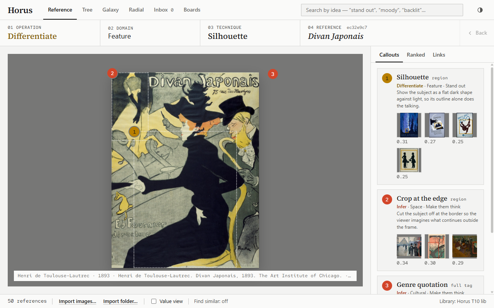
</p>

## The problem

An artist collects hundreds of reference images for a project. Folders and mood boards sort these images by subject or by style. They do not show why an image works.

For example, a film still and a poster can use the same silhouette against a light background. A folder keeps them apart. Horus connects them through the technique "Silhouette".

Horus is for illustrators, concept artists, photographers, and designers who keep their own reference collections.

## Screenshots

<table>
  <tr>
    <td width="50%">
      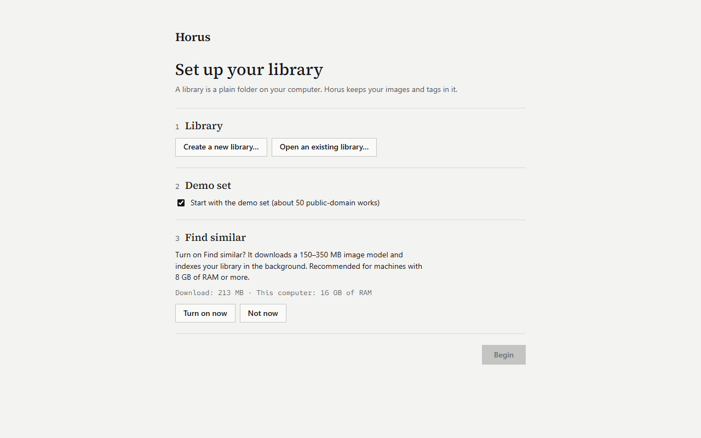
      <br><sub><strong>First run.</strong> Make a library folder, add the demo set, and decide about Find similar.</sub>
    </td>
    <td width="50%">
      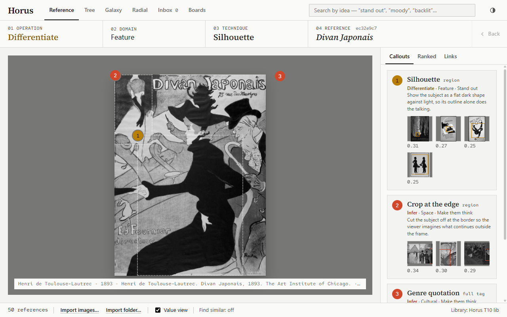
      <br><sub><strong>Value view.</strong> Show all images in grayscale to compare light and dark values.</sub>
    </td>
  </tr>
  <tr>
    <td width="50%">
      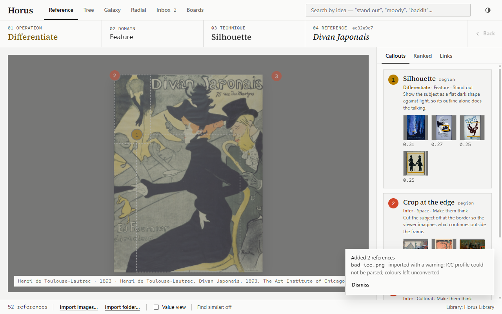
      <br><sub><strong>Import summary.</strong> Horus tells you what it added, what it skipped, and why.</sub>
    </td>
    <td width="50%">
      
      <br><sub><strong>Callouts.</strong> Each numbered callout names a technique and shows related references with a score.</sub>
    </td>
  </tr>
  <tr>
    <td width="50%">
      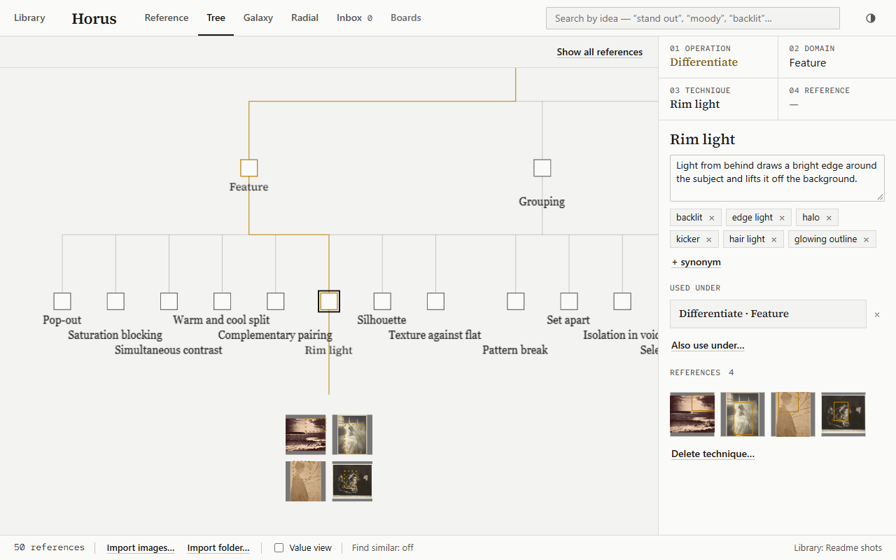
      <br><sub><strong>Tree view.</strong> Select a technique to show its path. The inspector shows its definition, synonyms, branches, and references.</sub>
    </td>
    <td width="50%">
      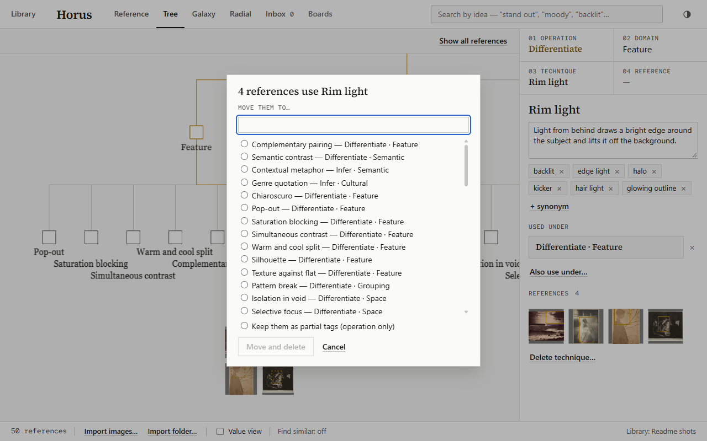
      <br><sub><strong>Safe delete.</strong> Before Horus deletes a technique, you move its tags to a different technique or keep them as partial tags.</sub>
    </td>
  </tr>
  <tr>
    <td width="50%">
      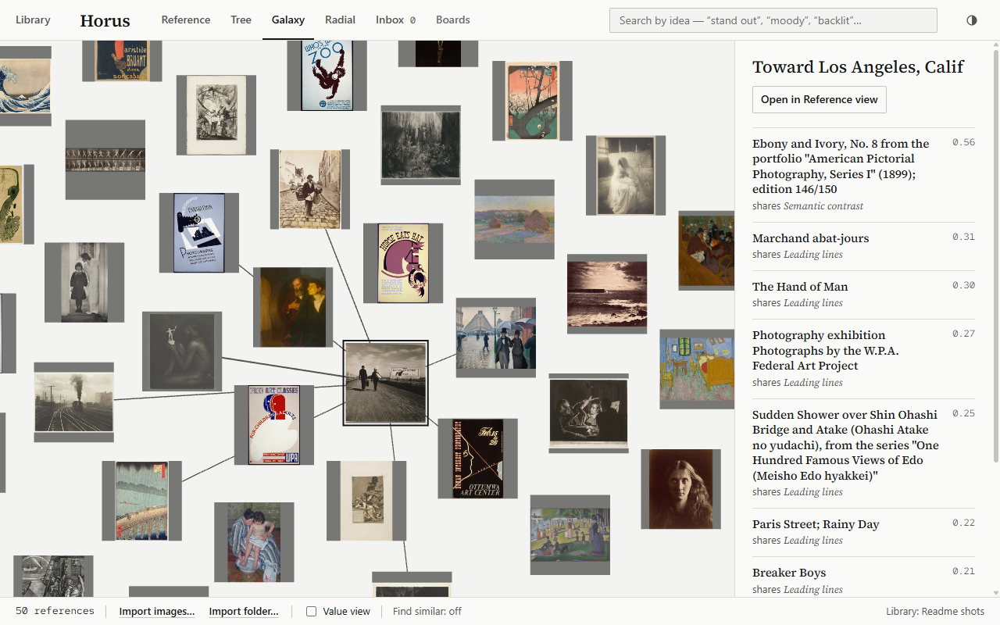
      <br><sub><strong>Galaxy.</strong> Edges show for the selected reference. The inspector lists related references with a score and a shared technique.</sub>
    </td>
    <td width="50%">
      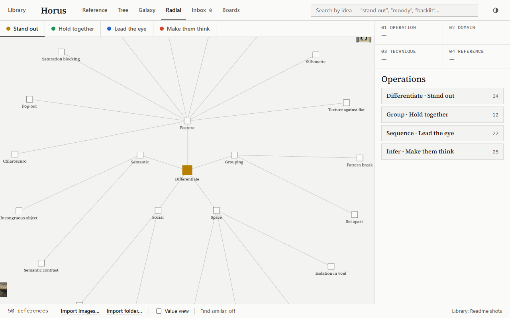
      <br><sub><strong>Radial.</strong> Differentiate ("Stand out") at the center, with its domains and techniques on rings. Use the tabs to change the operation.</sub>
    </td>
  </tr>
  <tr>
    <td width="50%">
      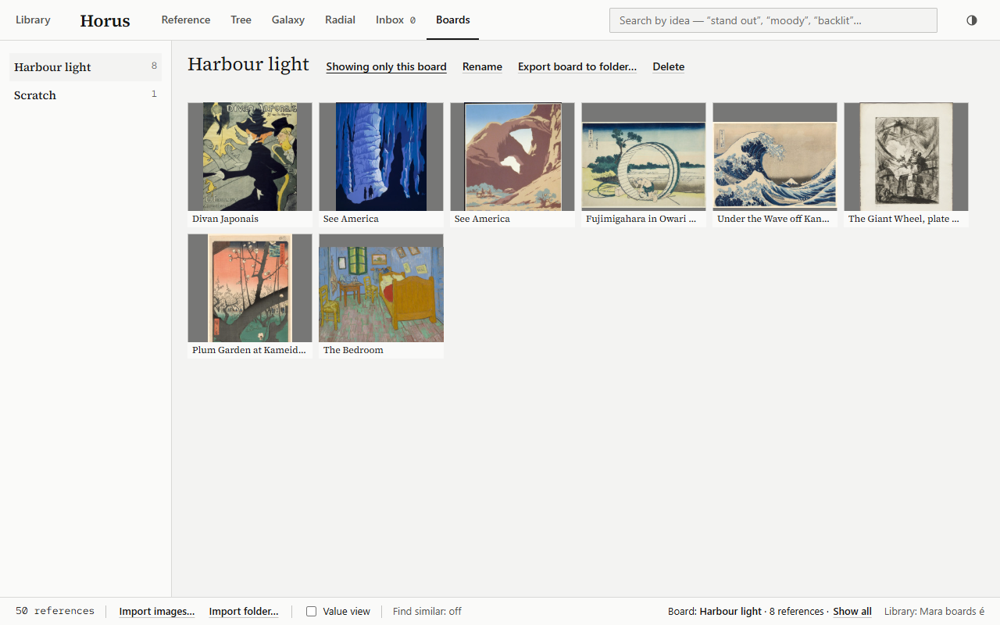
      <br><sub><strong>Boards.</strong> Collect references for a project. Change their order, or show only that board in the other views.</sub>
    </td>
    <td width="50%">
      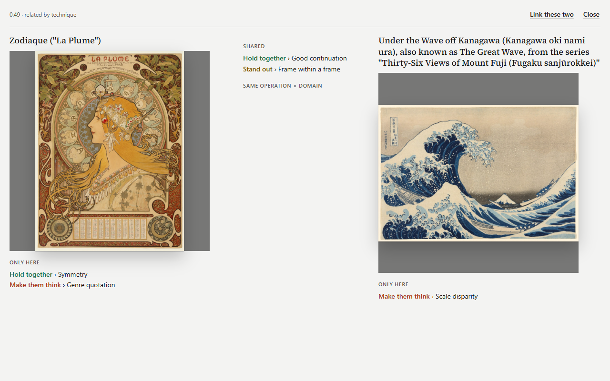
      <br><sub><strong>Compare.</strong> Two references side by side. The shared techniques are in the middle, and the unique techniques are on each side.</sub>
    </td>
  </tr>
</table>

## Features

- **Technique tags in four levels.** Each tag has an operation, a domain, a technique, and a reference. An example is "Differentiate → Feature → Silhouette".
- **Region tags.** You can tag one part of an image. The callout box shows the region on the image.
- **Related references with a score.** Horus compares the tags of two references. Rare techniques count more than common techniques. The score uses cosine similarity with IDF weights.
- **Search by idea.** Type a plain word, for example "moody" or "backlit". Horus finds the techniques that match, through their names, synonyms, and descriptions.
- **Tree view.** The Tree shows the taxonomy in four bands, from top to bottom: operations, domains, techniques, and references. The inspector on the right shows the selected item. A breadcrumb at the top of the inspector shows its path.
- **Taxonomy editing.** In the Tree inspector, you can rename an item, write its definition, and add or remove synonyms. Each edit is one undo step. Press `Ctrl+Z` to undo it.
- **Safe delete.** When you delete a technique, Horus shows how many references use it. You move its tags to a different technique, or you keep them as partial tags (operation only).
- **Operations and domains.** A library can have 1 to 9 operations. Each operation has its own ink color. Each domain has an icon.
- **Drag to link.** Drag a technique onto a different branch in the Tree. The technique then also occurs under that branch. Without a mouse, use **Also use under…** in the inspector.
- **Galaxy.** The Galaxy shows all references as points. A force layout puts references with high correlation scores near each other. The layout runs in a Web Worker.
- **Galaxy edges.** The Galaxy draws edges only for the hovered or selected reference. Each edge goes to one of its 8 strongest neighbors.
- **Radial view.** The Radial shows one operation at a time. The operation is at the center. Its domains, techniques, and references are on three rings. Press `1` to `9` to show a different operation.
- **Keyboard control.** In the graph views, `+` and `-` zoom, `0` fits the full graph, and the arrow keys pan. With a selection, the arrow keys move the selection. `Enter` opens the selected reference in the Reference view.
- **Boards.** A board is a named group of references for a project. Press `b` on a reference to open the board menu, then tick or clear a board. You can also make a new board there. In the Boards view, drag a tile, or press `Alt+←` and `Alt+→`, to change the order.
- **Show only this board.** This command limits the Ranked list and the search results to the references on the board. The graph views dim the other references. A line at the bottom shows the board and its count, with a **Show all** command.
- **Export a board.** Horus copies the original files of a board into a folder that you select, with numbers in board order, for example `1 - Title.jpg` and `2 - Title.jpg`. It also writes `credits.txt`. It never writes over a file: a name that exists gets ` (2)`. **Show in folder** opens the parent folder in the file manager, with the export folder selected.
- **Links that you draw.** Link two references and write why they are connected. Press `k`, or drag the link handle onto a different reference. Two references can have only one link. Your links show first, under "Linked by you". They never change a score.
- **Lightbox.** Press `l` to see the image at full size. Zoom with the mouse wheel or `+`, `-`, `0`, and `1` (100%). Pan with `Space`+drag or the middle mouse button. Region tags show as outlines; move the pointer over one, or press `Tab`, to see its name. Press `o` to hide the outlines.
- **Lightbox preview.** The lightbox shows JPEG, PNG, WebP, and GIF files at full size, up to 8,192 px. For a TIFF file or a larger image, Horus makes a PNG preview one time and keeps it in the app's cache folder. A note tells you that you see a preview.
- **Compare.** Shift-click a different reference in the Reference view or the Galaxy. Compare shows the two references side by side. The shared techniques are in the middle. The unique techniques are on each side. Press `v` for the value view, `x` to change the sides, and `Esc` to close.
- **Value view.** Press `v` to show all images in grayscale.
- **Safe import.** Horus copies each image into the library and does not change the original. It finds duplicates through a BLAKE3 hash. It makes 256 px and 1024 px thumbnails.
- **Correct color and orientation.** Horus converts embedded color profiles to sRGB for thumbnails. It applies the EXIF orientation of phone photos.
- **Safe saves.** Horus writes each save to a temporary file first. It keeps a backup copy of the last good library file. It can open a library from its backup.
- **Demo set.** The app includes 50 public-domain works with suggested tags. Use them to learn the app before you add your own images.
- **Local and offline.** Horus does not use a server or an account. The library is a folder that you own.
- **Light and dark themes.** The image card stays the same neutral grey in both themes. This keeps the colors of your references accurate.

## How it works

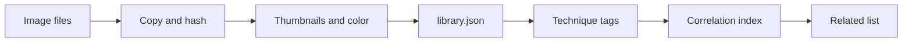

1. **Import.** Select images or a folder. Horus copies each file into `images/` and gives it a hash name.
2. **Prepare.** Horus makes two thumbnails for each image. It converts the color to sRGB.
3. **Save.** Horus records each reference in `library.json`. It writes a backup before each save.
4. **Tag.** You tag each reference with techniques in the Inbox or in the Reference view. The demo set comes with suggested tags.
5. **Index.** Horus counts how often each technique occurs. Rare techniques get a higher weight.
6. **Relate.** Horus compares the tag sets of two references. It shows the strongest matches first.

### The library folder

| Item | Contents |
|---|---|
| `library.json` | All references, tags, and links |
| `library.bak.json` | The last good copy of `library.json` |
| `taxonomy.json` | The operations, domains, and techniques for this library |
| `images/` | Copies of the original images, named by their BLAKE3 hash |
| `thumbs/256/`, `thumbs/1024/` | Thumbnails in two sizes |

If you select a folder that contains other files, Horus makes the library in a `Horus Library` subfolder. It does not change your other files.

## The taxonomy

The seed taxonomy has 4 operations, 6 domains, and 48 techniques. The four operations are:

| Operation | Plain label |
|---|---|
| Differentiate | Stand out |
| Group | Hold together |
| Sequence | Lead the eye |
| Infer | Make them think |

A technique can occur under more than one operation and domain. The full taxonomy is in [`taxonomy/taxonomy.json`](taxonomy/taxonomy.json), with a description and citation for each technique.

## Run it locally

### Prerequisites

- Windows 10 or Windows 11
- [Rust](https://rustup.rs/) (stable, MSVC toolchain)
- Visual Studio Build Tools with the "Desktop development with C++" workload
- [Node.js](https://nodejs.org/) 24
- Microsoft Edge WebView2 (Windows 11 has it)

### Start the app in development mode

1. Open a terminal in the `app` folder.
2. Install the packages:

   ```bash
   cd app
   npm install
   ```

3. Start the app:

   ```bash
   npm run tauri dev
   ```

4. On the first-run screen, select **Create a new library…**.
5. Keep **Start with the demo set** selected.
6. Select **Begin**.

### Run the tests

```bash
cd app
npm test
cd src-tauri
cargo test
```

### Make the Windows installers

1. Open a terminal in the `app` folder.
2. Make the release build:

   ```bash
   npm run tauri build
   ```

3. Find the installers in `app/src-tauri/target/release/bundle/`:
   - `msi/Horus_0.1.0_x64_en-US.msi`
   - `nsis/Horus_0.1.0_x64-setup.exe`

The installers are not signed. Windows SmartScreen can show "Windows protected your PC". To continue, select **More info**, then **Run anyway**.

## Project status

Horus is an early beta. The project has six plans in [`docs/superpowers/plans/`](docs/superpowers/plans/).

| Plan | Scope | Status |
|---|---|---|
| 1 | Foundation: library, import, related references, search, first run, Windows build | Done |
| 2 | Tagging, Inbox, undo and redo, drag and drop, library menu | Done |
| 3 | Tree, Galaxy, and Radial views; taxonomy editing | Done |
| 4 | Boards, Lightbox, Compare, and links between references | Done |
| 5 | Find similar (local SigLIP image model) and Settings | Planned |
| 6 | Intro card, macOS and Linux builds, release checks | Planned |

## Architecture

| Path | Responsibility |
|---|---|
| `app/src-tauri/src/library.rs` | Library folder, safe save, and backup recovery |
| `app/src-tauri/src/import.rs` | Copy, hash, thumbnails, color conversion, and duplicate check |
| `app/src-tauri/src/taxonomy.rs` | Load and validate the taxonomy |
| `app/src-tauri/src/correlate.rs` | Related-reference scores and the Galaxy edges (`graph_edges`) |
| `app/src-tauri/src/search.rs` | Search by idea |
| `app/src-tauri/src/edit.rs`, `history.rs` | Validated edits to tags and the taxonomy, with undo and redo |
| `app/src-tauri/src/commands.rs` | Tauri commands that the UI calls |
| `app/src-tauri/src/commands/taxonomy_edit.rs` | Tauri commands for taxonomy edits |
| `app/src-tauri/src/export.rs` | Board export to a folder, with `credits.txt` |
| `app/src-tauri/src/demo.rs` | Demo set seed |
| `app/src/` | TypeScript UI: Reference view, first run, and import |
| `app/src/graph/` | Graph engine: camera, culling, level of detail, texture cache, layouts, PixiJS scene, and the force-layout worker |
| `app/src/views/` | Tree, Galaxy, and Radial views, the inspector, the move-tags dialogs, and the technique form |
| `app/src/boards/` | Boards view, the board menu, the board scope line, and export |
| `app/src/links/` | Link editor |
| `app/src/compare/` | Compare view |
| `app/src/lightbox/` | Lightbox: zoom and pan (`zoom.ts`), and the tag picker docked in the lightbox (`dock.ts`) |
| `taxonomy/` | Seed taxonomy and its check script |
| `demo/` | Demo images, manifest, and rights record |
| `prototype/` | HTML prototype of the Reference view |
| `scripts/make_perf_library.py` | Synthetic 2,500-reference library for the [performance check](app/README.md#performance-check) |

For the product design, read [`SPEC.md`](SPEC.md), [`PRODUCT.md`](PRODUCT.md), and [`DESIGN.md`](DESIGN.md).

## Limits

- You cannot edit the title, creator, year, or credit of a reference yet.
- Compare opens from the Reference view and the Galaxy only. It does not open from the Tree or the Radial.
- **Show in folder** opens the parent folder and selects the export folder in it. It does not open the export folder.
- At the zoom that fits the full graph, the Tree and the Radial hide the names of items. Zoom in to read them. Plan 6 adds a minimum name size.
- In the Tree, **Show all references** draws the references of each technique as one thin column.
- A long import shows "Importing…" only. It does not show a count or a Cancel button yet.
- Only Windows builds are available. Plan 6 adds macOS and Linux builds.
- Nobody has tested the installers on a computer without a network connection yet.
- The security policy (CSP) still allows inline styles. Plan 6 removes this permission.

## Data and privacy

- Horus does not send data over the network.
- Horus does not change your original image files. It copies them into the library folder.
- All library data stays in the library folder on your computer.
- Horus uses `tauri-plugin-opener` only to show an export folder in the file manager.
- Lightbox previews of TIFF files and very large images stay in the app's cache folder on your computer.

## Credits

- **Demo images:** The Art Institute of Chicago (CC0) and the Library of Congress (no known restrictions on publication). Each item has its rights record in [`demo/README.md`](demo/README.md).
- **Fonts:** Source Serif 4 (Adobe) and Red Hat Mono (Red Hat), under the SIL Open Font License 1.1.
- **Taxonomy:** The seed technique names come from the Iris™ taxonomy by Modern Art Direction. The descriptions and links are original. [`SPEC.md`](SPEC.md) §7 records the IP position. A legal review must occur before a public release.

## License

This repository does not have a license yet. The author keeps all rights.
